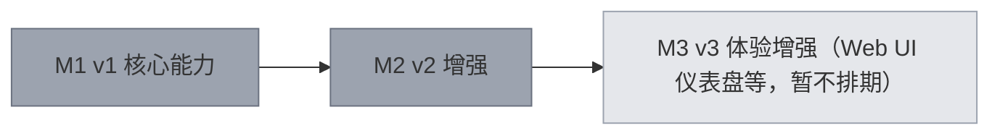

# pm-mcp — 项目仪表盘

> ⚠️ 本文件由 pm-mcp 自动生成（勿手改）。状态账本写入后自动刷新；手动刷新用 regenerate_dashboard。
> 生成时间: 2026-10-20T15:18:17.226Z
> AI 编码项目的单一事实来源 + 健康台账 MCP 服务

## 🗺️ 路线图

✅ [██████████] 100% M1 v1 核心能力（9/9）
✅ [██████████] 100% M2 v2 增强（30/30）
○ [░░░░░░░░░░] 0% M3 v3 体验增强（Web UI 仪表盘等，暂不排期）（0/1）

## 🎯 当前焦点
- （无进行中任务。从 backlog 挑一个开始，或 add_task 创建。）
- 当前阶段: v0.3.0 本地验收通过：固定安装目录已配置，既有客户端待重连核验；未发布

## 🩺 健康摘要
| 账本 | 状态 |
|---|---|
| 漂移（防幻觉） | ✅ 无 |
| 债务（反挤出） | ✅ 无未清债务 |
| churn（变更率） | ⚠️ 热点 README.md(30), package.json(18), src/index.ts(16) |
| 安全 | ✅ 无未处理发现 |
| 调试知识 | 23 条记录 |
| 测试背书 | 33/33 个功能带测试 |
| 语义治理 | 1 模块 / 1 接口 / 1 仓库 |
| 质量矩阵 | ✅ 2026-10-20 15:17（命令 1/1；证据 tests_observed） |
| 标准化验收 | ✅ 2026-09-17 15:22（需求 33/33，errors 0） |

## 🧭 模块与语言治理
- pm-mcp [tool] typescript · owner project-maintainers · roots .
- 策略: ownership=true · declared-deps=true · public-interfaces=true · unresolved=true · source-coverage≥80% · semantic≥ast · regex-fallback=forbidden · quality=test,build,typecheck,coverage
- 实时语义结果：pm://architecture / audit_governance；跨仓：pm://portfolio。

## 📋 任务
- 总览: done 67 · backlog 1

## 🧩 功能清单
### src
- ✅ F-001 状态与任务管理 — init/get_status/任务生命周期/checkpoint 断点
- ✅ F-002 路线图 — 里程碑+自适应渲染+重构配额告警
- ✅ F-003 结构对账审计 — 完整性/增长/漂移/债务/churn/复杂度/索引/足迹/测试/Git 十节对账
- ✅ F-004 安全体检 — 已识别密钥/危险模式/依赖元数据启发式扫描+台账闭环
- ✅ F-005 许可证审计 — copyleft 冲突+GPL 头+provenance
- ✅ F-006 求证检索 — search_code + 七类知识源（含治理模型）检索 + annotate_file
- ✅ F-007 自动仪表盘 — PROJECT.md 与 changelog.md 生成
- ✅ F-009 跨文件/模块/语言语义治理 — 结构化模块/owner/公开接口、TypeScript Compiler与六语言Tree-sitter AST、hash-bound runtime evide
- ✅ F-010 标准化产品验收与防伪证据链 — 版本化预批准质量基线、ISO 25010九特性/25040五阶段、需求风险测试追踪、冻结JSON Pointer、证据与报告SHA-256及机器判定门禁
- ✅ F-011 编译器与多语言 AST 语义治理 — TypeScript Compiler API与六语言Tree-sitter AST、symbol-bound调用边、hash-bound原生/运行时证据和严格
- ✅ F-012 统一 MCP 客户端安装器 — 一个 npx setup 命令自动检测 Codex、Claude Code、ZCode、Cursor、VS Code；支持备份、dry-run、force 与通
- ✅ F-013 多 Agent 读写幂等协调 — 跨进程合并完全相同的并行读；写工具提供显式业务幂等键与自动瞬时去重；键冲突 fail-closed，长写锁按进程存活性安全接管。
- ✅ F-014 多 Agent 故障恢复与单 watcher 协调 — 业务提交间隙强杀采用 at-most-once + uncertain fail-closed；SQLite 生命周期锁消除 stale-lock ABA/PI
- ✅ F-015 使用日志与运行日志 — get_usage_log/get_runtime_log：工具调用计量（成败/耗时/输出与折叠省下的 token 估算，验证省不省 token）与服务级运行事
- ✅ F-016 任务合并更新与当前源码验证 — update_task合并进度、checkpoint和可选会话；feature/fix完成时校验最新真实质量报告、任务文件与当前源码摘要，保留48工具和旧账本读
- ✅ F-017 内容摘要对账与可配置扫描范围 — 按多会话内容摘要核对Git变化，识别删除和重命名；统一扫描、搜索、语言发现、指纹及实时索引的缓存排除范围，无文件名监听通知标脏恢复。
- ✅ F-021 WorkBuddy 客户端接入与配置核验 — 统一安装器新增 workbuddy 客户端：按 WORKBUDDY_CONFIG_DIR → ~/.workbuddy-ai → ~/.workbuddy 解析
### scripts
- ✅ F-008 字节/超大LOC容量基准 — 按精确字节与LOC生成可扫描代码树，验证结构、watcher、安全、许可证覆盖并安全清理
### MCP 运行与配置
- ✅ F-018 MCP 运行版本核验与受控本地升级 — setup 支持固定本地包升级、仅替换目标启动参数并备份；doctor 新建连接核验版本、项目根和48工具，明确区分既有客户端重连。
### 任务管理
- ✅ F-019 任务游标分页与结构化结果 — list_tasks 提供受预算约束的完整分页与 structuredContent；游标绑定项目、过滤条件和数据版本；pm://tasks 截断后提供续读入口
### 质量验证
- ✅ F-020 完成证据分级与明确兼容策略 — 区分未验证、仅执行、测试已观察和覆盖率已观察；默认拒绝未知测试计数完成任务，兼容策略须注明理由并保留失败/零测试/过期证据约束。
### 工具目录核验
- ✅ F-022 pm-mcp probe：标准 raw tools/list 直连探针 — 绕过宿主以 MCP client 身份直连任意 stdio 服务器，取标准 raw tools/list 原始响应（自动翻页取全），支持 --expect/--
- ✅ F-023 定时巡检工具目录探针（TOOL_CATALOG_SIZE 漂移检测） — 健康巡检（npm run audit → scripts/health-check.mts）在巡检 pm-mcp 自身仓库时，自动用 pm-mcp probe 
### 语义治理
- ✅ F-024 dependency_graph 依赖图查询与文件级循环检测 — 查询跨文件/模块依赖图：全局摘要（关系/环/入出边枢纽 Top5）、模块与文件级循环列表、聚焦文件的依赖邻域（BFS，direction deps|depend
### 质量与组合
- ✅ F-025 find_duplicates 重复代码检测（行指纹聚类） — 零依赖重复代码检测：行指纹（注释剥离/字符串占位/空白归一化）滑动窗口聚类，跨文件重复块按长度降序；min_lines 4-20（默认 6）、limit 可调；
- ✅ F-026 audit_osv 联网漏洞查询（显式确认门控） — OSV.dev 已知漏洞查询（联网、默认关）：复用多语言 manifest 解析收集依赖，仅发送包名/版本/生态到 api.osv.dev querybatch
### 仪表盘
- ✅ F-027 pm-mcp ui 本地只读 Web 仪表盘 — 本地只读 Web 仪表盘：`pm-mcp ui [--root <项目>] [--port <端口>]`（端口 0 自动分配），仅绑定 127.0.0.1，GE
### 安全
- ✅ F-028 search_code_public 公开代码反查（ 版权溯源初版） — 公开代码反查（GitHub Code Search，联网默认关）：把一段本仓源码行作为词项 AND 查询发给 GitHub，列出包含相同代码的公开仓库；conf
### audit
- ✅ F-029 Git 对账应用项目级扫描排除 — Git 工作区对账尊重项目级 scan_ignore，避免显式排除的运行时/产物变更进入 unaccounted 或 unverified。
### clients
- ✅ F-030 Qoder 客户端接入（工作区解析适配器） — 让 Qoder 用户级一条 MCP 配置服务所有工作区：resolveRoot 支持客户端工作区提示与未插值占位符防护；dist/qoder-launch.js
### MCP 服务端
- ✅ F-031 按请求认领项目根（多窗口共用常驻进程） — 客户端（如 Qoder）把一个常驻 MCP 子进程复用给所有窗口时，项目根不再在启动时定格，而是每次工具调用重新认领调用方工作区：显式 root 参数 > 会话
### pm-mcp
- ✅ F-032 Qoder 按请求认领工作区与 launch 接入 — Qoder 多窗口共用常驻子进程时项目根不再启动期钉死：服务端按「工具名+参数+紧时间窗」指纹倒扫会话运行日志拿调用方 cwd，root_source 如实标注
- ✅ F-033 git 对账 fallback 解析 — 宿主进程 PATH 缺 git 时 resolveGitCommand 按 PATH → where git → 常见安装路径兜底解析并缓存；changedGi

## 🏛️ 架构决策（最近）
- [ADR-007-输出行数预算显式设为-100（默认-150）](.pm/decisions/ADR-007-输出行数预算显式设为-100（默认-150）.md)
- [ADR-006-Qoder-项目根改为按请求认领：常驻子进程被所有窗口共用，ppid-与启动期-](.pm/decisions/ADR-006-Qoder-项目根改为按请求认领：常驻子进程被所有窗口共用，ppid-与启动期-.md)
- [ADR-005-Qoder-项目根解析：按-ppid-匹配会话运行日志，而不是钉死---root](.pm/decisions/ADR-005-Qoder-项目根解析：按-ppid-匹配会话运行日志，而不是钉死---root.md)
- [ADR-004-语义治理采用AST保证分层与运行时证据扩展](.pm/decisions/ADR-004-语义治理采用AST保证分层与运行时证据扩展.md)
- [ADR-003-标准化验收采用冻结基线与机器证据指针](.pm/decisions/ADR-003-标准化验收采用冻结基线与机器证据指针.md)

## 📜 最近会话
- 2026-09-20 [qoder] 修好 Qoder 多窗口共用常驻进程时项目根被启动期定格的缺陷（T-064）。取证：Qoder 只派生一个 stdio 子进程给所有窗口（pid 24452 自 09-19 22:55 存活，09-20 三个 session token 共用同一 server uuid），所有 run 日志目录名都是主进程 pid，所以 ADR-005 的 ppid 匹配不成立。改为按请求认领：新增 caller-workspace.ts 用「工具名+参数+紧时间窗」指纹倒扫会话日志拿 initial_cwd，tool-base 每次调用下发 RequestContext，54 个工具全部改用当次根；registrar 形参改名 startupRoot 让漏改编译不过。适配器不再伪造 --root，改传 PM_MCP_ROOT_HINT(_SOURCE)，root_source 不再永远报 --root；歧义时不猜并列出候选。get_status 的 structuredContent 补齐全量状态（Qoder 的 mcp_call 只呈现结构化载荷）。ADR-006 记录并标记 ADR-005 被取代。351 测试全过，quality gate PASS，并用 dist 真实派生 + 真实日志回放双重取证。
  - 改动: src/caller-workspace.ts, src/tool-base.ts, src/qoder-launch.ts, src/paths.ts, src/project-tools.ts, src/index.ts, src/governance-tools.ts, src/audit-tools.ts 等 15 个
- 2026-09-19 [?] T-063 Qoder 客户端接入：工作区提示解析 + qoder-launch 适配器：Qoder 真实派生的新会话已实测通过：新建独立会话调用 mcp__pm_mcp__get_status 返回 root=E:\通用型项目管理、root_source=--root、version 0.5.0，证明用户级一条配置（node .../dist/qoder-launch.js，不带 --root）在 Qoder 里能起服务并把项目根钉到当前工作区。换工作区验证同一条配置：QODER_WORKER_CWD 指向 unified-ai-system 时 root 随之切换，各工作区各归各账本。当前这个会话需 /mcp reload 才会拿到连接。
- 2026-09-19 [qoder] 把 pm-mcp 接入 Qoder 做成受支持能力：根解析支持客户端工作区提示与未插值占位符防护，新增 qoder-launch 适配器 + launch 子命令，setup/doctor 支持 --client qoder，并用真命令把用户级配置改写为一条不钉根的适配器条目；配套 11 个用例与 README 章节。
  - 改动: src/paths.ts, src/qoder-launch.ts, src/index.ts, src/project-tools.ts, src/setup.ts, src/setup-project.ts, src/doctor.ts, src/cli.ts 等 12 个
- 2026-09-19 [?] T-063 Qoder 客户端接入：工作区提示解析 + qoder-launch 适配器：代码/测试/文档/真机配置全部落地：coverage 336 通过、doctor --client qoder 返回 ok:true 且 root 正确、用户级配置已由 setup --client qoder --local 写成 dist/qoder-launch.js 一条（其他 server 保留，写前有备份）。
- 2026-09-19 [zcode] 完成 T-055：changedGitFiles/gitAudit 现在尊重项目级 scan_ignore，补充忽略路径、规则清空恢复及普通源码保留的回归测试；typecheck 与 325 项全量测试通过。
  - 改动: src/git-state.ts, test/management-upgrade.test.ts

---
stack: TypeScript, Node.js>=22.18 · modules: src, test, scripts · exposure: public · license: MIT
